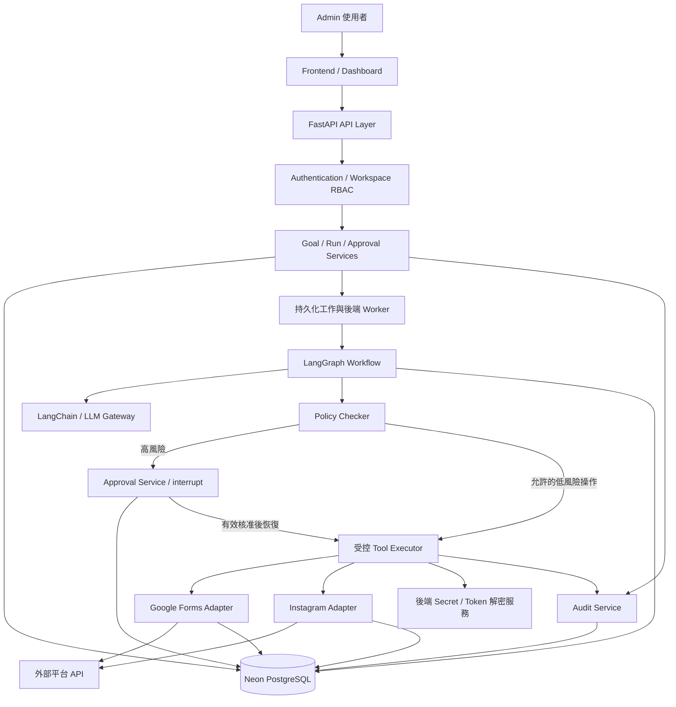
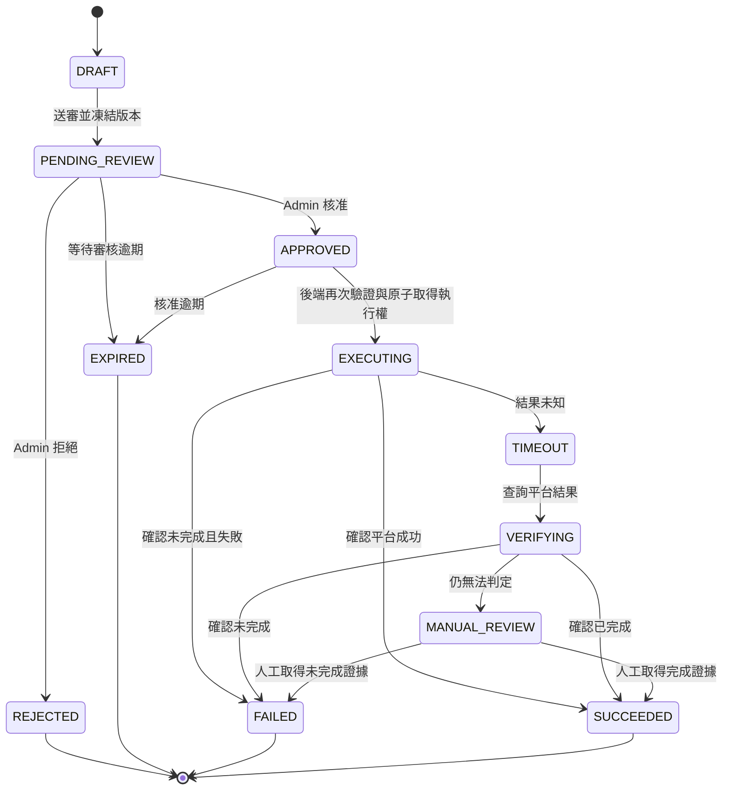

# 系統架構規格書

## 1. 目的與規格依據

本系統協助社團設定行銷目標，由 Agent 讀取授權資料、提出策略及貼文草稿，經人員核准後由後端執行發布，持續收集成效並產生下一版策略。核心循環為：

`Goal → Plan → Execute → Observe → Evaluate → Update`

本文件定義元件責任、資料流、信任邊界、角色權限、審核流程、資料模型、API 契約方向與驗收標準，作為各串接模組的共同介面。

### 1.1 實作狀態

以下狀態區分「規格已定義」與「程式已實作」，避免把設計誤寫成既有功能。

| 主題 | 規格章節 | 目前狀態 |
| --- | --- | --- |
| 系統架構、信任邊界與資料流 | 第 3、4 節 | 規格已定義；Frontend、Agent workflow、外部 Adapter 與 worker 為後續實作 |
| 角色與權限矩陣 | 第 5 節 | 規格已定義；目前後端僅有 development API key 閘門，尚未完成 OIDC 與完整 RBAC |
| 高低風險政策與 Approval State Machine | 第 6、7 節 | 規格已定義；`approval_requests` 與受控執行流程尚未實作 |
| Audit Log 欄位與保存規則 | 第 10 節 | 規格已定義；`audit_logs` 資料表與寫入服務尚未實作 |
| OAuth、Token、API key 與 Secret 保存 | 第 11 節 | 本機與 GitHub Actions 已採用；Vercel runtime 設定尚待驗證，OAuth connection 加密保存為後續實作 |
| 安全與整合測試 | 第 14 節 | 核心資料庫與 API 測試已存在；審核、OAuth、外部平台與 worker 情境為後續驗收 |

本機目前已驗證 Neon 連線、Alembic migration、核心 workspace 外鍵、可重複 seed、`/health`、Goal → Strategy → Execution 基本 API，以及讀取查詢的資料庫重試。雲端 Vercel 部署仍依賴 Project 環境變數與 Deployment Protection 的 CI bypass 設定，未成功驗證前不得宣稱部署完成。

## 2. 系統範圍

### 2.1 第一階段 MVP

- Admin 建立工作目標、KPI、使用平台、執行期間與資源限制。
- Google Forms 以輪詢方式讀取指定表單回覆，保存來源識別並避免重複匯入。
- Instagram 完成 OAuth 與至少一項授權讀取操作。
- Agent 根據授權情境產生策略版本、Instagram 草稿與審核請求。
- Admin 檢視確切內容並核准或拒絕；後端阻擋未核准發布。
- 在符合平台權限與測試帳號條件下，由受控後端執行一次發布測試。
- 保存執行、外部事件、觀測、審核與稽核紀錄。
- 展示一次結果評估與下一版策略草稿；新的發布內容必須重新核准。

若平台權限未就緒，可用明確標示的模擬 Adapter 驗證流程，但不得將模擬發布宣稱為真實平台串接成功。

### 2.2 後續階段

Email 寄送、多帳號管理、正式投放、Google Forms 建立與修改、推播通知、進階模型路由，以及長期多輪實驗評估，均不作為第一階段必要交付。額外功能需先補齊權限、風險與驗收規格。

## 3. 目標架構

| 元件 | 目標 |
| --- | --- |
| Frontend | 目標設定、草稿審核、執行進度、成效比較介面 |
| FastAPI | 身分驗證、權限、業務 API、執行控制 |
| Neon 連線 | 補齊實際連線驗證、錯誤處理、連線池設定 |
| 資料模型 | 工作空間隔離、行動、審核、事件、觀測、OAuth 與稽核 |
| Agent workflow | LangGraph 編排、LangChain 模型介面、可恢復審核中斷 |
| 外部整合 | Google Forms、Instagram Adapter |
| Migration／seed | 版本化 schema、可重複執行的測試資料 |
| 部署 | GitHub CI；Vercel 部署前端與 FastAPI；獨立 worker 執行長任務 |

### 3.1 系統架構圖



長時間任務不得依賴單一 HTTP 請求持續存活。MVP 使用 PostgreSQL `workflow_jobs` 與獨立 Python worker，不額外引入 Redis 或外部 queue。LangGraph checkpoint 保存工作流程位置，不能取代工作排程、權限驗證或審核紀錄。Worker 初期可由開發者本機 CMD 啟動；雲端運行使用 Render Background Worker，與 Vercel API 共用同一套後端程式及 Neon 資料。

### 3.2 元件責任與信任邊界

| 邊界／元件 | 責任與限制 |
| --- | --- |
| 瀏覽器 → FastAPI | 所有輸入不可信；後端驗證身分、workspace membership、角色、欄位及請求大小；前端隱藏按鈕不能當授權 |
| FastAPI → Neon | 只有後端與受控 worker 持有 DB 憑證；所有查詢按 workspace 隔離；不得直接採信 client 傳入的 workspace 身分 |
| Agent → 執行器 | LLM 輸出是提案，須經結構驗證與固定規則檢查；模型不能決定自己的權限或核准結果 |
| 外部資料 → Agent | 表單、貼文及 API 回應都是資料；其中的指令不得覆蓋系統政策或要求取得 secret |
| 執行器 → 外部平台 | Adapter 只允許登錄的工具、操作與帳號；執行前重驗 OAuth 狀態、scope、核准內容及有效期 |
| 後端 → LLM 供應商 | 只傳送必要且去識別的情境；不傳 OAuth token、DB URL 或原始含個資回覆 |
| Runtime → migration | 執行期帳號不具有 schema 變更權限；migration 使用分離帳號，正式環境不得靠啟動時 `create_all` 管理 schema |

## 4. 主要資料流

### 4.1 目標、草稿、審核與發布

1. Admin 經驗證後建立 Goal，設定 KPI、可用工具、平台帳號及資源限制。
2. `POST /runs` 建立 Execution 與持久化工作，立即回傳 run ID，交由 worker 執行。
3. Context Loader 載入同一 workspace 的目標、歷史策略及去識別觀測資料。
4. Planner 產生 Strategy 新版本及 Action Draft；資料庫保留原版本。
5. Policy Checker 按固定工具清單分類風險；未知操作預設拒絕。
6. 低風險操作經授權與限額檢查後執行；高風險操作建立 Approval Request，保存 checkpoint 並暫停。
7. Admin 看到確切草稿、平台帳號、資源用量與版本，提交核准或拒絕。
8. Approval Service 持久化決策；只有核准才排入恢復工作。拒絕不得進入執行器。
9. 後端執行器重新驗證角色、工作空間、版本雜湊、期限、OAuth 與唯一執行權，再呼叫 Adapter。
10. 儲存外部結果、平台識別碼與 Audit Log，更新 Action 與 Execution 狀態。
11. Observer 在指定觀測窗口收集成效；Evaluator 比較 KPI，保存評估及下一版策略草稿。

發布成功只代表操作成功，不代表達成行銷目標。單次發布 API 回應與後續成效觀測分別保存。

### 4.2 Google Forms 匯入

`輪詢工作 → 驗證授權 → 讀取指定 Form responses → external_events → 正規化 → observations → 更新輪詢進度`

- 以 workspace、平台、連線、表單與 response ID 建立來源唯一識別。
- 原始回覆屬受限制資料，保存於後端；只向 Agent 提供必要的聚合或去識別資訊。
- 保存來源時間、擷取時間、處理狀態、嘗試次數與錯誤碼。
- 分頁、游標與進度只有在相應資料持久化後才推進；重跑不得新增重複事件或重複 observation。
- 同一 response 若允許修改，以來源更新版本或內容雜湊保存新版本，不覆蓋歷史結果。
- 無法歸因到特定策略的回覆，明確標記為未歸因，不將全部報名數自動算給最新策略。

## 5. 角色與權限

系統僅有 Admin 與 Agent 兩種業務角色，此決策已由使用者於 2026-10-15 確認。Agent 是受限服務身分，不是共享 Admin 帳號；FastAPI 執行器是受控基礎設施，不是另一個可供使用者登入的業務角色。

| 操作 | Admin | Agent |
| --- | --- | --- |
| 建立／修改 Goal 與限制條件 | 允許 | 禁止 |
| 查看授權範圍內目標、策略與結果 | 允許 | 允許 |
| 產生策略、caption 與 action 草稿 | 允許 | 允許 |
| 修改策略 | 建立新版本 | 只能建立新草稿，不修改已核准版本 |
| 啟動／停止 workflow | 允許 | 僅依 Admin 預設範圍與執行上限觸發 |
| 讀取授權表單資料 | 允許，需工作需要 | 只取得允許的去識別資料 |
| 查看原始含個資回覆 | 允許，需留下存取紀錄 | 禁止 |
| 讀取 Instagram 帳號、貼文或成效 | 限已授權帳號及 scope | 限已授權工具與資料範圍 |
| 提交審核請求 | 允許 | 允許 |
| 核准／拒絕高風險操作 | 允許 | 禁止 |
| 直接持有 token 呼叫發布 API | 禁止，統一走執行器 | 禁止 |
| 觸發已核准 action 的受控執行 | 允許 | workflow 只提出執行要求，無權繞過驗證 |
| 管理使用者、OAuth 與工具設定 | 允許 | 禁止 |
| 查看 OAuth 連線狀態 | 允許 | 僅可取得任務所需的可用／失效狀態 |
| 查看 secret 或完整 OAuth token | 一般 API 不提供 | 禁止 |
| 查看 Audit Log | 限所屬 workspace | 僅任務所需且經遮罩的摘要 |
| 修改／刪除 Audit Log | 禁止 | 禁止 |

所有授權必須在後端強制執行，跨 workspace 的資源查詢與審核一律拒絕。MVP 允許 Admin 核准本人建立的草稿，但必須有獨立且明確的核准動作，不得以建立草稿或啟動工作代替核准；本版不要求雙人覆核。

## 6. 風險政策

| 操作 | 分類 | 核准與執行規則 | 失敗處理 |
| --- | --- | --- | --- |
| 讀取授權 Forms／Instagram 資料 | 低風險，但資料可能敏感 | 限指定來源、scope 與資料存取權 | 有界重試，授權失效即停止 |
| 整理資料、計算 KPI、產生草稿 | 低風險 | 限資源額度與輸出 schema | 有界重試，不改變原始資料 |
| Instagram 發布、修改公開內容 | 高風險 | Admin 核准特定內容與帳號，後端執行 | 結果未知先查證，不直接重發 |
| Email 寄送 | 高風險，後續階段 | 核准內容、收件範圍與數量 | 需獨立去重與投遞查證規格 |
| 使用付費資源 | 高風險 | 核准資源範圍與金額上限 | 額度耗盡停止，不自行提高預算 |
| 變更 OAuth 權限 | 高風險 | Admin 明確發起平台授權流程 | 不由 Agent 自動擴權 |
| 刪除／覆寫資料 | 高風險 | MVP 不開放 Agent 工具；人工管理另定規格 | 不以重試取代復原程序 |

模型呼叫可在 Admin 已核准的供應商、模型與累計額度內執行；新供應商、擴大額度或額外付費操作需重新核准。風險低不代表資料公開或不需要驗證身分。

## 7. 審核與執行狀態機

為避免審核決策和 API 執行結果混淆，以下圖表為一個 Action 的整體生命週期；資料庫分別保存 `approval_requests.status` 與 `execution_actions.status`。



### 7.1 必要不變條件

- 核准只能由有效 Admin 身分建立，Agent 及未授權服務不得自行核准。
- 審核綁定 workspace、action ID、draft version、目標帳號、操作種類與 `content_hash`。
- 雜湊涵蓋 caption、媒體檔版本／雜湊、發布參數與資源限制；僅對可變媒體 URL 計算雜湊不足以凍結內容。
- 已送審內容不可原地修改；內容變更須建立新草稿與新審核，原核准不得用於新內容。
- 等待審核期限為送審後 72 小時，核准有效期為核准後 24 小時；工作期限以 Goal 結束時間為準，取先到期者。三者分欄保存，到期即禁止執行。
- 真正執行時重新檢查 Admin 權限仍有效、工作未取消、scope 仍有效、核准未過期且內容完全一致。
- `APPROVED → EXECUTING` 必須在交易中以條件更新或鎖定取得唯一執行權，禁止僅先讀取狀態再無條件呼叫外部 API。
- 同一 action 不得重複發布；確認失敗後需新建 action／attempt 與重新送審，保留原始紀錄。
- Timeout 不等於失敗；先查詢外部狀態。若平台無法提供可靠查證方式，轉人工處理，不自動重發。
- 每次狀態轉換記錄操作者、原因、時間與版本；不得任意從終態改回待執行。

### 7.2 LangGraph 恢復

送審資料與 checkpoint 必須持久化後才呈現等待審核。`interrupt()` 只暫停流程，`Command(resume=...)` 只恢復流程；兩者均不代表取得發布授權。恢復時只能載入資料庫已記錄的審核結果，不接受 client 自稱 approved 的 payload。重啟後待審 action 不自動核准，也不能重新執行已成功的外部副作用。

## 8. 資料模型與一致性

下表為目標邏輯 schema，並非已存在的 migration。MVP 全部業務主鍵沿用整數 BIGINT identity，API 不以 ID 難猜測取代授權。工作流程 thread、冪等 key 及 session 使用隨機識別值。時間統一以 UTC、具時區欄位保存，介面依 Asia/Taipei 顯示。

| 資料表 | 主要欄位／用途 | 關聯與約束 |
| --- | --- | --- |
| workspaces | id、name、status | 租戶隔離單位 |
| members | id、workspace_id、subject_id、role、status | 同 workspace 與登入 subject 唯一 |
| auth_sessions | id、member_id、token_hash、csrf_token_hash、created_at、last_seen_at、expires_at、revoked_at | 高熵 session token 僅雜湊保存；每次請求檢查 member 仍有效 |
| service_credentials | id、workspace_id、role、token_hash、expires_at、revoked_at | role 固定 Agent，僅用於受限後端任務 |
| idempotency_records | workspace_id、actor_id、route、key、request_hash、response_ref、expires_at | 複合唯一鍵，避免並行重送建立重複工作 |
| goals | id、workspace_id、title、description、kpi_definition、constraints、period、created_by | 有執行紀錄時不得任意覆寫原執行依據；變更保留版本快照 |
| strategies | id、workspace_id、goal_id、version、content、rationale、parent_strategy_id、input_snapshot | `(workspace_id, goal_id, version)` 唯一，保留歷史版本 |
| executions | id、workspace_id、goal_id、strategy_id、status、iteration、limits、started_at、finished_at、error_code | 對外稱 run；沿用 executions 名稱，避免另建重複 runs 表 |
| execution_actions | id、workspace_id、execution_id、tool、operation、target_ref、draft_version、content_hash、payload_ref、status、idempotency_key、external_id | 每個 action 的執行權唯一；所有來源關聯須同 workspace |
| approval_requests | id、workspace_id、action_id、draft_version、content_hash、status、requested_by、reviewed_by、decision_reason、requested_at、decided_at、expires_at | 綁定不可變版本；同 action 不得存在多筆有效核准 |
| oauth_connections | id、workspace_id、provider、account_ref、scopes、status、expires_at、token_ciphertext 或 secret_ref、key_version | API 僅暴露授權狀態，禁止序列化 token |
| external_events | id、workspace_id、provider、connection_id、source_object_id、source_version、event_type、raw_payload_ref、received_at、processing_status、attempts、error_code | 來源複合唯一鍵；原始個資限制存取 |
| observations | id、workspace_id、external_event_id、goal_id、strategy_id、execution_id、metric、value、observed_at、window、attribution_status | 事件與正規化項目唯一；無可靠歸因時允許策略關聯為空 |
| evaluations | id、workspace_id、execution_id、observation_refs、kpi_snapshot、analysis、recommendation、model_version | 保存評估依據；建議與事實分欄，不能把模型推論當實測值 |
| audit_logs | 詳見第 10 節 | 一般角色與執行期帳號不得更新／刪除 |
| workflow_checkpoints | thread_id、checkpoint_id、workflow_version、state、updated_at | 實體 schema 依持久化套件決定；thread 與 workspace/run 綁定，不存明文 token |
| workflow_jobs | id、workspace_id、execution_id、type、status、attempts、available_at、lease_until、lease_token、last_error | 持久化排程與恢復；租約 token 防止舊 worker 回寫新任務結果 |

### 8.1 資料庫約束與交易

- workspace_id 不只由 API 篩選，關聯需以複合 FK 或等效 DB 約束防止跨 workspace 綁定。
- Action 領取、核准消耗與執行中紀錄必須在單一交易內保存；交易完成後才呼叫外部服務。
- 外部 API 和 PostgreSQL 無法共用一個原子交易。必須記錄外呼意圖與平台 ID，並用查證流程處理「平台成功、DB 回寫失敗」。
- 資料庫唯一鍵防止重複領取，但不能單獨保證外部 API exactly-once；只有平台支援時才轉送 idempotency key，否則保留不確定結果並停止重發。
- external_event 的正規化與 observation 去重採交易處理；每次重跑不能重複累加 KPI。
- schema 變更由版本化 migration 管理；seed 僅使用虛構測試資料，不含正式 token 或真實個資。

## 9. API 契約

下表是目標 API 契約。現有後端已實作 `/health`、Goal、Strategy 與 Execution 的基本 development API；其餘端點仍待實作。所有正式端點需先驗證登入與 workspace 存取權。Admin 採 Google OpenID Connect 登入，後端以已驗證的 issuer／subject 對應預先邀請的 members；第三方平台 OAuth 與系統登入分開管理。後端建立可撤銷的 opaque session，Neon 只保存 session token 雜湊、期限及 member 關聯。Agent 使用 workspace 綁定的獨立服務憑證，僅保存雜湊，不能作為 Admin session 使用。

| Method / Path | 用途 | 主要授權／回應 |
| --- | --- | --- |
| `GET /health` | 基本服務與 DB 健康檢查 | 可公開最小結果；異常回傳 503，不回傳連線字串 |
| `POST /goals` | 建立目標、KPI 與限制 | Admin；201 |
| `GET /goals/{id}` | 查詢目標 | 同 workspace 的授權身分 |
| `POST /runs` | 建立持久化 workflow 工作 | Admin 或受限排程；202，回傳 execution_id |
| `GET /runs/{id}` | 狀態、策略、action 與摘要 | 同 workspace；不含原始 secret 或個資 |
| `POST /runs/{id}/cancel` | 停止後續排程 | Admin；不能撤銷已發出的平台請求 |
| `GET /actions/{id}` | 查看不可變草稿版本 | Admin；Agent 僅可查看授權摘要 |
| `POST /actions/{id}/approval-requests` | 提交特定版本審核 | Admin／Agent；201 |
| `GET /approval-requests` | 待審核清單 | Admin，限 workspace |
| `POST /approval-requests/{id}/decision` | 核准或拒絕 | Admin；附 decision、reason、expected_version |
| `POST /actions/{id}/execute` | 請求受控執行 | Admin／內部 workflow；不得直接傳入 token 或覆蓋草稿 |
| `GET /runs/{id}/observations` | 成效與觀測窗口 | 同 workspace，按資料敏感度過濾 |
| `GET /oauth-connections` | 連線狀態 | 遮罩後的狀態，不回傳 token |
| `GET /oauth/{provider}/callback` | 處理外部授權回呼 | 驗證一次性 state 與發起者綁定，不能只依賴一般 API 登入規則 |
| `GET /audit-logs` | 稽核查詢 | Admin，限 workspace |

建立 Run、執行 Action 與審核決策等變更介面需支援冪等請求；相同 key 與相同內容重送回傳原結果，不建立第二次副作用。key 相同但內容不同回傳 409。錯誤 envelope 統一為 `error.code`、安全的 `message`、`request_id`；未登入 401、無權限 403、狀態／版本衝突 409、欄位錯誤 422。外部失敗的診斷細節僅保存於受限制的後端紀錄。

Frontend 透過狀態 API 顯示待審、執行中與結果，MVP 可先輪詢；不得持有 Neon、OAuth 或模型供應商 secret。

## 10. Audit Log 規格

| 欄位 | 說明 |
| --- | --- |
| id、workspace_id、occurred_at | 事件識別、所屬空間、UTC 時間 |
| actor_type、actor_id、actor_role | human／agent／system，記錄當時身分與角色 |
| event_type、resource_type、resource_id | 如 approval.approved、action.started、oauth.revoked |
| goal_id、strategy_id、execution_id、action_id | 可回溯同一條工作鏈 |
| approval_request_id、approved_by | 相關審核與核准者 |
| draft_version、content_hash | 實際操作的內容版本 |
| provider、operation、external_id | 外部服務、操作與平台結果識別 |
| before_summary、after_summary、payload_ref | 遮罩摘要與受限內容參照，不複製所有個資或 token |
| result、http_status、error_code、error_message | 成功／拒絕／失敗／不確定，以及去敏後錯誤 |
| request_id、correlation_id、source_ip | 請求與工作鏈追蹤；IP 按個資政策限制保存 |
| attempt、retryable、idempotency_key | 重試及去重資訊 |

權限拒絕、個資讀取、審核、狀態變更、工具呼叫、重試與授權失效均須記錄。高風險操作若無法先保存執行意圖與 audit，不得外呼。外呼後記錄失敗則進入查證流程。

「不可修改」指一般使用者及應用執行期帳號無 UPDATE／DELETE 權限；資料庫管理者仍具有管理能力，不宣稱具備不可竄改儲存。Audit 預設保留 180 天，只存遮罩摘要，來源 IP 最多保留 30 天。逾期資料由獨立維護身分清理，另留清理批次與筆數紀錄；Admin 可匯出所屬 workspace 的去敏紀錄，不取得底層刪除權限。

## 11. Secret、OAuth 與個資

- 本機後端 secret 放 `backend/.env`，範本放 `backend/.env.example`；Git 只提交不含 secret 的範本。
- 前端設定放 `frontend/`；任何被打包進瀏覽器的環境變數均視為公開資訊，只能放 API base URL 等非機密設定。
- CI 使用 GitHub Secrets，部署使用各環境的 secret 管理功能；development、preview、production 使用不同憑證與資料庫環境。
- OAuth token 只保存加密密文或 secret reference；加密金鑰獨立於資料庫，保存 key version 並規劃輪替。
- DB URL、OAuth client secret、access／refresh token、模型 API key、JWT／session 與 webhook secret 不得進入 Git、LLM context、checkpoint、API response 或一般 log。
- OAuth 回呼驗證 state、redirect URI 與發起使用者，依供應商支援採用 PKCE；重新授權需由 Admin 發起。
- token 過期／撤銷標記 connection 不可用，阻擋後續工具執行並通知 Admin；不得無限刷新或擴大 scope。
- Admin session 使用 HttpOnly、Secure、SameSite=Lax Cookie，閒置 8 小時或最長 24 小時到期；登出或停權即撤銷。變更資料的請求驗證 CSRF token 與 Origin。Frontend 將 `/api/*` 同源轉送至 FastAPI，不將 session 寫入 localStorage；後端仍自行驗證 Cookie 與來源，不信任偽造轉送標頭。
- 個資原始資料與 Agent 可用資料分層，log 只存安全摘要。原始表單回覆保留 30 天，之後刪除或去識別；去識別觀測、策略與執行資料保留 180 天。備份視窗以 30 天為上限，正式環境須選用能符合此設定的備份方案；刪除請求寫入維護紀錄，還原備份後須先重放刪除紀錄，再開放資料存取。此為專案預設，不宣稱取代個別資料來源的告知與授權義務。

## 12. 錯誤、重試與資源限制

| 情況 | 必要行為 |
| --- | --- |
| 讀取 API 暫時錯誤／限流 | 初次失敗後最多重試 3 次，基準等待 2、4、8 秒加抖動；若有 Retry-After 則延後持久化排程，不阻塞 HTTP 請求 |
| OAuth 失效、scope 不足、欄位或權限錯誤 | 不盲目重試，保存錯誤類別並等待修正／授權 |
| 發布請求 timeout、斷線或 worker 中斷 | 標記結果未知，先查證；禁止依一般讀取重試政策重發 |
| 資料庫交易失敗 | 回滾；僅可重試不含未查證外部副作用的交易 |
| workflow 重啟 | 由持久化工作與 checkpoint 恢復，再驗證狀態、版本與權限 |
| 模型格式錯誤或輸出未知工具 | 驗證失敗並保留安全錯誤，不能執行任意程式或 URL |
| 迭代、時間或金額超限 | 停止後續工作，記錄停止原因；不得由 Agent 自行增加上限 |

每個 run 必須設定最大迭代、外部呼叫次數、token／金額預算與 deadline。具體值須在啟動前由配置或 Goal 提供；未設定必要限制時不得啟動持續迭代。新的策略版本不繼承舊版本的發布核准。

資料庫採每個 process 一個 engine、每次工作／請求獨立 session，保留現有 `pool_pre_ping`；pool size、overflow、timeout 依 Neon 配額與 worker 數共同限制，避免每個 process 各自開滿連線。不得在 DB 交易內等待人工審核或長時間外部 API。

## 13. 目錄、開發與部署

```text
frontend/                      # 目前只有說明；目標採 React + TypeScript + Vite
  .env.example                 # 未來前端需要時建立，僅公開設定
backend/
  .env                         # 本機 secret，不提交
  .env.example                 # 已有後端範本
  meta_api_test/               # Meta OAuth / Instagram API 獨立測試沙盒
    .env                       # 沙盒憑證，不提交
    .env.example               # 沙盒設定範本
  requirements.txt
  app/
    main.py                    # 已有
    config.py                  # 已有，固定讀取 backend/.env
    db.py                      # 已有
    models.py                  # 已有基本模型
    api/                       # 規劃：HTTP 路由與輸入輸出 schema
    services/                  # 規劃：授權、審核與執行控制
    workflows/                 # 規劃：LangGraph 節點與恢復
    adapters/                  # 規劃：Google Forms、Instagram
  migrations/                  # 已有 Alembic schema 版本
  seed.sql                     # 已有可重複執行的虛構測試資料
  tests/                       # 已有資料庫與基本 API 整合測試
docs/
  plans/                       # 已有計畫書
  系統架構規格書.md
```

GitHub CI 已執行依賴安裝、編譯檢查、資料庫與 API 測試、migration、seed 與 schema check；不得使用正式 token 執行測試發布。Vercel 部署 workflow 已建立，但 Project 環境變數與 Deployment Protection 的 CI bypass 必須完成設定，且 `/health` 驗證成功後才算部署完成。

前端與 FastAPI 分別建立 Vercel Project，Root Directory 為 `frontend` 與 `backend`。Vercel API 只處理短請求、審核與排入工作，不在記憶體中等待審核或執行持續輪詢；獨立 worker 執行 LangGraph 與定時工作。Worker 雲端目標為 Render Background Worker，不代表本次已建立服務或購買方案。

Neon 是唯一業務資料庫。development、preview、production 使用分離 branch／憑證；preview 從不含正式個資的開發基線建立，不從 production 複製資料。Schema 使用 Alembic：PR 在隔離測試 branch 執行 upgrade 與 seed 驗證；main 發布時由單一 CI 工作先 migration，再部署相容的 API／worker。正式部署移除啟動時 `create_all`；失敗時停止部署，不自動執行破壞性 downgrade。

平台依據：[Vercel FastAPI](https://vercel.com/docs/frameworks/backend/fastapi)、[Render Background Workers](https://render.com/docs/background-workers)。上述平台選擇是架構決策，實際可用功能與部署驗收需在建置時確認。

## 14. 安全與整合驗收

以下為待建立的驗收案例，不代表已執行通過。

| 編號 | 測試情境 | 預期結果 |
| --- | --- | --- |
| T01 | 未登入查詢 Goal／Run | 401，無資料洩漏 |
| T02 | 跨 workspace 存取、審核或建立關聯 | 403／404 或 DB 約束拒絕，不能越權 |
| T03 | Agent 核准自己的請求 | 403，審核狀態不變，有拒絕紀錄 |
| T04 | 未核准／已拒絕 action 呼叫 execute | 拒絕，外部 Adapter 呼叫次數為 0 |
| T05 | 核准 A 版本後變更 caption／媒體／目標帳號 | 原核准不能執行新內容，需重新送審 |
| T06 | 核准逾期或核准者權限被撤銷 | 執行前阻擋，不呼叫發布 API |
| T07 | 兩個 worker 同時執行同一 action | 只有一個取得執行權，不重複發布 |
| T08 | 發布 timeout 但平台實際成功 | 查證並關聯既有平台 ID，不再次發布 |
| T09 | 發布結果無法查證 | MANUAL_REVIEW，停止自動重試 |
| T10 | 同一 Forms 回覆／未來 webhook 重送 | 原始事件及正規化結果去重，不重複累加 KPI |
| T11 | token 出現在例外、外部回應或請求 | API／log 遮罩；一般查詢不含完整 token |
| T12 | 外部資料包含提示注入指令 | 不改變角色、政策或 secret 存取，不執行未知工具 |
| T13 | 審核中服務重啟 | checkpoint 可恢復，仍等待 Admin 決策 |
| T14 | 外部成功後 DB 回寫失敗 | 恢復後查證既有結果，不重複發布 |
| T15 | 修改／刪除 audit log | 一般 API 與 runtime DB 身分均遭拒絕 |
| T16 | 迭代／預算／執行時間達上限 | 停止後續任務，保留原因與剩餘狀態 |
| T17 | 外呼前無法保存審核消耗與執行意圖 | 不發出高風險 API 請求 |
| T18 | LLM context 與 Agent 回應檢查 | 不含 OAuth secret、原始個資或跨 workspace 資料 |

整合 Demo 路徑：

`建立 Goal → 產生 Strategy → 建立 Instagram draft → 送審 → 展示未核准被阻擋 → Admin 核准 → 後端發布測試 → 保存 external event → 產生 observation → 查詢 audit → 成效評估／下一版草稿`

驗收需保存可去識別的 request ID、action ID、審核版本、平台結果識別、資料庫紀錄及測試結果。Google Forms 成功讀取與去重、Instagram 真實讀取、真實發布與模擬發布需分項記錄。

## 15. 實作基準與交付順序

### 15.1 固定技術與預設參數

| 項目 | 定案規則 |
| --- | --- |
| Frontend | React、TypeScript、Vite；頁面為目標管理、策略／草稿、審核、Run 詳情、成效、OAuth 設定；API 透過同源 `/api` |
| 模型與編排 | LangGraph＋PostgreSQL checkpointer；LangChain 作模型介面；MVP 每個環境只配置一個文字模型，不做動態模型路由。供應商與 model ID 由後端 allowlist 配置；未配置則停用 Planner，不能使用前端任意指定的模型 |
| 依賴版本 | 首次實作時選用相容版本並鎖定直接與間接依賴，CI 以鎖檔安裝；不在規格書預填未驗證的套件版本 |
| Instagram | 採 Instagram Login 路線與測試 Professional Account；Adapter 僅暴露讀取與受控發布。串接者交付對應 API 版本的最小 scope 清單及測試證據，超出權限時停用功能，不自動切換登入路線或擴權 |
| Forms | 每個已啟用表單每 5 分鐘排一次匯入；Admin 配置 question ID → 指標／個資欄位 mapping。只讀取回覆，不建立或修改表單；無 tracking 對應資料即標記未歸因 |
| 成效觀測 | 發布後 1、24、72 小時建立觀測工作；以平台實際可取得指標為準，缺值標記 unavailable，不填 0。每輪評估以 24 小時資料為預設窗口，等待以排程實現 |
| Worker | MVP 一個 worker、同時一個外部副作用；每 5 秒查詢到期工作，以 `FOR UPDATE SKIP LOCKED` 領取；租約 120 秒，每 30 秒續期，回寫核對 lease_token。外呼中租約失效進查證，不直接重領發布 |
| Run 限制 | 最多 3 輪策略、50 次外部 API 呼叫、50,000 模型總 token、US$1 模型成本、累積主動運算 15 分鐘；任一達標停止。等待審核與觀測不計主動運算，但仍受 Goal deadline 約束 |
| 成本計算 | 後端維護模型單價設定與每次請求 token 上限，先預留預估成本再呼叫；無法計價即不啟動付費呼叫，最後以實際用量結算；Admin 可在 Goal 調低限額，提高限額需另記錄明確核准 |
| Timeout | 對外單次讀取 30 秒、發布 60 秒、模型呼叫 90 秒；外部可能仍在處理的發布 timeout 一律進 VERIFYING |
| 連線池 | Vercel HTTP API 使用 Neon pooled URL 與 SQLAlchemy NullPool；worker 使用 pool_size=2、max_overflow=0、pool_timeout=10 秒；migration 與 checkpoint 使用獨立直連設定並限制連線數 |
| OAuth token 保存 | 後端以具驗證的對稱加密保存 token 密文，key version 同列保存，加密金鑰置於部署 secret；輪替時支援舊金鑰解密與新金鑰重加密，禁止將密鑰存回 Neon |
| 身分生命週期 | 僅邀請制 Admin；Agent 服務憑證 30 天到期、可立即撤銷，只在受控後端使用。停權、登出及角色變更後立即失效，不等 Cookie 自行過期 |

### 15.2 狀態與資料契約補充

- `approval_requests.status` 只允許 PENDING_REVIEW、APPROVED、REJECTED、EXPIRED；消耗核准以 consumed_at 與 action 關聯記錄，不把執行結果覆寫成審核結果。
- `execution_actions.status` 允許 DRAFT、PENDING_REVIEW、APPROVED、REJECTED、EXPIRED、EXECUTING、SUCCEEDED、FAILED、TIMEOUT、VERIFYING、MANUAL_REVIEW；低風險操作可由 DRAFT 經 policy 檢查直接進 EXECUTING，不建立假核准。
- `executions.status` 使用 QUEUED、RUNNING、WAITING_APPROVAL、WAITING_OBSERVATION、SUCCEEDED、FAILED、CANCELLED、MANUAL_REVIEW。SUCCEEDED 表示本輪已完成，不代表 KPI 達標；KPI 結論保存在 evaluations。
- 每輪策略建立獨立 Execution，以 parent_execution_id 串連；第 15.1 節的輪數、成本與呼叫上限按同一輪次鏈累計，不能新建 run 規避限制。策略執行中不可改寫 strategy_id。
- Canonical JSON（固定排序與編碼）加媒體內容雜湊產生 SHA-256 content_hash；審核時保存確切快照。MVP 使用測試帳號既有可存取媒體，不新增使用者檔案上傳服務。
- API 變更操作接收 `Idempotency-Key`，以 workspace、actor、route、key 唯一；保存請求雜湊與結果 7 天。Action 副作用唯一性永久由 action 資料約束，不能隨 key 清理而失效。
- `/health` 的資料庫例外已轉為安全的 503 回應並附 request ID；不得回傳連線字串、SQL 或 driver 內容。部署前仍須以 Vercel 實際環境完成一次 `/health` 驗證。

### 15.3 交付順序

1. 建立 Alembic、workspace／member／session 與核心 FK，完成虛構 seed 及 Neon 連線驗收。
2. 實作身分驗證、權限矩陣、Goal／Run／Action API 與 audit；先完成 T01–T06、T11、T15。
3. 實作不可變草稿、審核交易、工作領取與 checkpoint 恢復，完成並行、重啟與 timeout 測試。
4. 完成 Forms polling、Instagram OAuth／讀取 Adapter；逐項登錄 API 版本、scope、來源 mapping 與錯誤分類。
5. 完成前端審核畫面、模擬發布測試，再以測試帳號完成真實受控發布；禁止對正式受眾自行測試。
6. 補齊 Observer、Evaluator、策略版本比較與剩餘測試，依第 14 節保存 Demo 證據。
